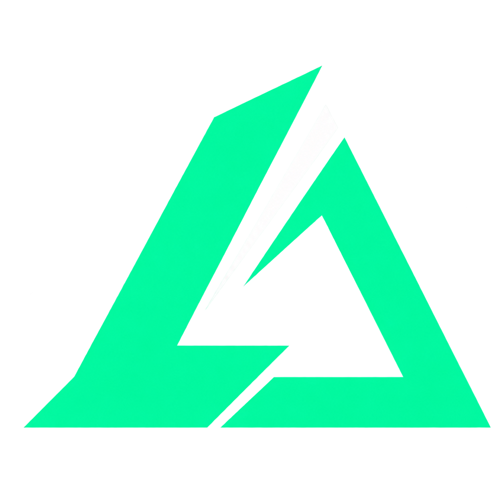

<p align="center"></p>

# LANDELTA · Race Studio

**Tu sesión, tus tiempos y tu telemetría en una sola app.**

Beta **0.14.0** para Windows 10/11 x64. AC, ACC e integración **experimental de iRacing**. Aplicación nativa C++17, local, sin cuenta ni suscripción.

## Descargar

La rama `feature/ac-studio` genera **LANDELTA-Setup-0.14.0.exe** en el artefacto `LANDELTA-Installer-0.14.0` de [GitHub Actions](https://github.com/Landsxd/landelta/actions). Es un único instalador: no necesitas descargar código fuente, scripts ni archivos de demo.

La publicación histórica v0.12.3 no contiene Race Studio ni iRacing. Comprueba **0.14.0** en la ventana de la app.

1. Sal de la copia anterior desde el icono junto al reloj; la X solo la deja en segundo plano.
2. Ejecuta el instalador. Conserva ajustes, historial y grabaciones.
3. Selecciona **AC, ACC o iRacing** arriba y entra en pista.
4. En ACC, si falta preparar pilotos: cierra el juego una vez y usa **Ajustes → Reparar ACC**.
5. Abre **Tu pantalla**, arrastra los paneles y pulsa **Guardar distribución**. Usa el juego en ventana sin bordes.

## Dentro de la app

| Área | Contenido |
| --- | --- |
| Sesión | Pista, coche, trazado registrado al conducir, vuelta actual, última y mejor registrada; tabla de vueltas y sectores; exportación PNG. |
| Telemetría | Gráficas de velocidad, freno, acelerador y volante por distancia; cursor de valores; comparación con otra vuelta; sectores o 10 microsectores. |
| Mis sesiones | Sesiones guardadas por juego y fecha; abre datos anteriores sin navegar por carpetas. |
| Tu pantalla | Miniatura del escritorio virtual, movimiento de overlays y distribución independiente por juego. |
| Ajustes | Conexión, captura AC, inicio con Windows, visibilidad, fondo y filas de clasificación. |

**Exportar sesión ZIP** incluye las muestras CSV originales, resumen de vueltas CSV y metadatos JSON. Los archivos siguen guardándose localmente, pero su acceso normal se hace desde LANDELTA.

## Overlays

| Juego | Paneles de esta beta |
| --- | --- |
| ACC | Clasificación con marcas, relativos, pedales, delta y últimos sectores. |
| AC | Pedales y delta local cuando existe referencia suficiente. |
| iRacing (experimental) | Clasificación, relativos, pedales y delta del SDK cuando está disponible. |

Se retiran del overlay **Ritmo / alcance** y **Vuelta / sectores**. Los tiempos y sectores se consultan dentro de la app. Los gaps marcados con `~` son estimaciones, no intervalos oficiales.

## Precisión y límites

- ACC/iRacing: captura de hasta **10 muestras nuevas/s** en esta beta. No equivale a registrar todos los ticks del simulador; los tiempos conservan los milisegundos que informa el juego.
- AC conserva el CSV de su grabador existente; el directo es una vista reducida y al abrir la sesión se cargan las muestras originales.
- Los microsectores son estimaciones interpoladas por distancia. Los huecos o cruces por meta sin evidencia suficiente quedan vacíos.
- Volante: unidades nativas en AC/ACC; radianes en iRacing. Pedales: entrada aplicada, no fuerza física del pie.
- Los datos no disponibles permanecen desconocidos. No se deduce validez de iRacing a partir de incidentes ni se inventan sectores oficiales.
- El trazado necesita coordenadas y se construye al conducir; no es un mapa precargado.
- El historial antiguo de ACC contiene tiempos, pero no puede recuperar telemetría que nunca se grabó.
- [Cambios y límites completos de 0.14.0](docs/RELEASE-0.14.0.md).

**Validación:** pruebas de lógica, compilación, capturas nativas y comprobación del instalador. Falta validar esta beta conduciendo en AC/ACC/iRacing, especialmente práctica → clasificación → carrera, pausa/reanudación y varios monitores. No se presenta como una versión ya validada en pista.

## Ventana y atajos

La ventana se puede maximizar y redimensionar. Minimizar la deja en la barra de tareas; cerrar con X la deja junto al reloj. Para cerrarla por completo usa **Salir de LANDELTA**.

| Atajo | Acción |
| --- | --- |
| Ctrl + Alt + F10 | Bloquear / desbloquear overlays. |
| Ctrl + Alt + F11 | Mostrar / ocultar overlays. |
| Ctrl + Alt + F12 | Abrir LANDELTA. |

La rueda sobre el delta desbloqueado cambia su tamaño. Los ajustes e historial se conservan al actualizar.

## Reportar errores

Indica versión, juego, circuito, modalidad, pasos y resultado esperado. Para ACC: **Ajustes → Diagnóstico**. Revisa rutas personales antes de compartirlo. No publiques contraseñas ni `broadcasting.json` completo.

## Compilar

Con [MSYS2](https://www.msys2.org/), terminal UCRT64:

```bash
pacman -S --needed mingw-w64-ucrt-x86_64-gcc
MSYS2_ARG_CONV_EXCL='*' cmd.exe /c build-windows.bat
```

Pruebas portables: `python3 tools/run-tests.py`. El ejecutable no requiere Python ni .NET. GitHub Actions compila y empaqueta el instalador de Windows.

## Apoya LANDELTA 🏁

### [💚 Donación voluntaria por PayPal](https://paypal.me/landeroslal)

Donar no es necesario para descargar ni usar LANDELTA.

Desarrollo: **Lands**. Nombre anterior: Vortex ACC Overlay. Proyecto independiente, sin afiliación con Kunos, iRacing, RaceLab ni SRO. Avisos de dependencias y marcas en [licenses](licenses/) y [vendor/JSON-LICENSE.txt](vendor/JSON-LICENSE.txt).
